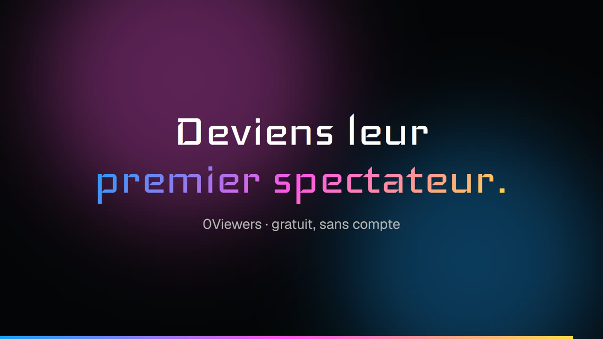

<h1 align="center">0Viewers</h1>

<p align="center"><strong>Deviens leur premier spectateur.</strong><br>
Les streamers Twitch français en direct devant 5 spectateurs ou moins.</p>

<p align="center">
  <a href="https://0-viewers.vercel.app">🎮 Site en ligne</a> &nbsp;
  <a href="https://baptisteledev.fr/portfolio/0viewers">📁 Fiche projet</a> &nbsp;
  🎓 Projet MDS B3
</p>

<p align="center">
  <a href="public/video/0viewers.mp4"></a>
  <br><sub>▶️ Cliquer pour voir la vidéo de présentation (10 s)</sub>
</p>

## Stack


## Le but

Sur Twitch, un streamer sans audience reste invisible : pas de spectateurs, donc pas de
découverte, donc pas de spectateurs. 0Viewers casse la boucle en montrant **uniquement** les
lives français à 5 spectateurs ou moins, en direct depuis plus de 10 minutes.

## Ce qu'on y fait

- 🃏 **Accueil** : cinq lives tirés au hasard en pile de cartes, plus un carrousel des lives du moment.
- 🔎 **Streamers** : les 150 premiers lives, avec recherche et filtres (dont tout public / adulte).
- 🗂️ **Catégories** : les catégories Twitch en direct, avec leur jaquette.
- 🎬 **Mode cinéma** : un clic ouvre le live et son chat en grand.
- 💜 **Connexion Twitch** (facultative) : soutenir ou signaler un streamer, un vote par live.

Tout se regarde sans compte. La connexion sert seulement aux votes.

## Sous le capot

- Une seule app **Next.js** (App Router). Les appels Twitch Helix restent côté serveur, les clés ne
  partent jamais au client ([ADR 0001](docs/decisions/0001-single-nextjs-app.md)).
- Les pages sont statiques : une visite ne déclenche ni fonction Vercel ni requête en base.
  Seuls la connexion, le profil et les votes passent par le serveur et **Neon**.
- Code découpé par contexte : `decouverte` (Twitch et règle de sélection), `compte`
  (OAuth Twitch, session signée), `vote`, `ui` (composants client).
- Qualité : typecheck, lint, tests Vitest, smoke test et **Lighthouse** (accessibilité et SEO à 1),
  plus CodeQL et ZAP pour la sécurité. Tout tourne en local avec `gh act`.

Détails : [ARCHITECTURE.md](ARCHITECTURE.md).

## L'équipe

| | Rôle |
|---|---|
| **Baptiste Dechamp** · [@BaptisteLeDev](https://github.com/BaptisteLeDev) · [portfolio](https://baptisteledev.fr) | Développeur full-stack |
| **Camille** · [@camille56](https://github.com/camille56) | Développeuse full-stack |

Projet de 3e année à MyDigitalSchool Vannes (B3).

<details>
<summary><strong>Lancer le projet en local</strong></summary>

```bash
bun install
cp .env.example .env.local   # clés Twitch, DATABASE_URL, SESSION_SECRET
bun run dev
```

Sans clés Twitch : `TWITCH_FIXTURES=1 bun run dev` utilise un jeu de données figé.

Tests et CI :

```bash
bun run typecheck && bun run lint && bun run test
TWITCH_FIXTURES=1 bun run build && bun run start   # puis bun run smoke
bun run ci         # CI complète via gh act (Podman sous Windows, Docker sous Linux)
bun run security   # CodeQL + ZAP
```

Déploiement Vercel : les variables de `.env.example` (Twitch, Neon, session, vérifications
Google et Bing, `OWNER_TWITCH_ID` pour `/admin`). Les previews sont en `noindex`.

</details>
